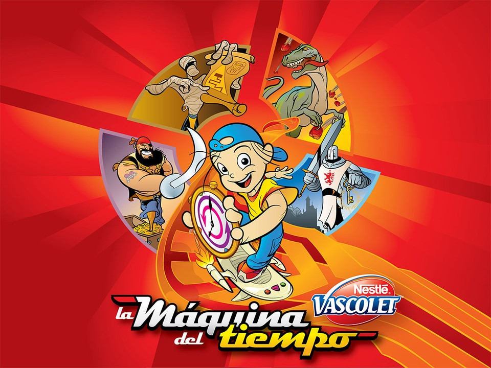
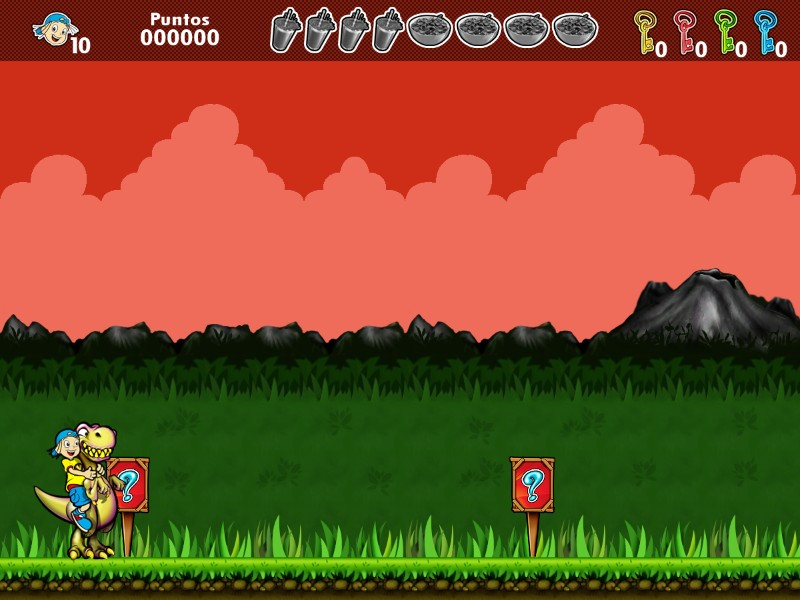
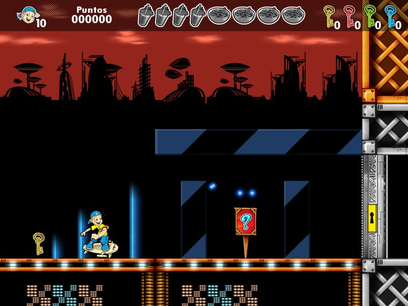

# Vascolet — La máquina del tiempo

<p align="center">
  
</p>

### [▶ Jugar en el navegador](https://frajusu.github.io/vascolet-1-web/)

Un desayuno interrumpido y un microondas averiado llevan a Alejandro por la **Prehistoria, Egipto, un castillo medieval, los piratas y el futuro**. El querido juego de plataformas de **Batoví Games Studio (2010)**, ahora en tu navegador.

## Un viaje de vuelta

Un port hecho con cariño para que aquel juego siga vivo: reencontrarse con su música y sus escenarios, y compartirlo con quienes lo descubren por primera vez.

Se recuperaron sus mapas, gráficos, animaciones y sonidos originales y se reconstruyó el juego para la web, conservando las cinco épocas, los menús y el guardado. Un homenaje no oficial para jugar y preservar.

<p align="center">
  
  
</p>

**Controles:** flechas para moverse y usar escaleras, **Espacio** para saltar y **Esc** para pausar. ¡Busca Vascolet y Cereales para mejorar tus saltos!

## Ejecutarlo localmente

```sh
npm ci
npm run serve
```

Abre **http://127.0.0.1:8124**. [Estado del port](docs/status.md) · [Cómo se reconstruyó](docs/reverse-engineering.md)

El juego y sus recursos pertenecen a sus autores y titulares originales. El código nuevo del port está bajo [MIT](LICENSE). Con todo el reconocimiento a Batoví y a este pedacito de nuestra historia de videojuegos.
